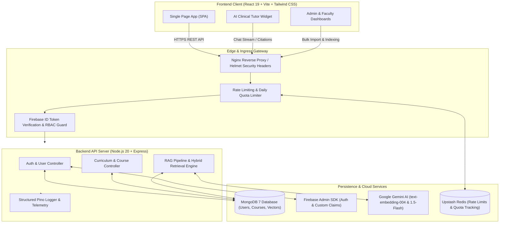

# MedPulse — Clinical Nursing LMS & RAG AI Tutor Platform

[](https://github.com/jayy1506/Nursing/actions/workflows/ci.yml)
[](https://nodejs.org/)
[](https://opensource.org/licenses/MIT)
[](http://localhost:5000/api/docs)
[](#accessibility)

**MedPulse** is an enterprise-grade clinical education and Learning Management System (LMS) purpose-built for nursing and foundational medical sciences under **Indian Nursing Council (INC) Competency-Based Medical Education (CBME)** standards.

MedPulse pairs interactive multi-track curriculum visualizers (Applied Anatomy, Applied Physiology, Applied Biochemistry, and Clinical Nutrition & Dietetics) with a **chapter-scoped, grounded AI clinical tutor** powered by Google Gemini and hybrid vector-keyword retrieval.

---

## 📸 Platform Preview & Demos

> [!TIP]
> **Live Demo**: [https://medpulse-nursing.vercel.app](https://medpulse-nursing.vercel.app) *(or your deployed staging URL)*  
> **Interactive API Docs (Swagger UI)**: [http://localhost:5000/api/docs](http://localhost:5000/api/docs)

| Clinical Curriculum Hub | Interactive AI Clinical Tutor | Admin Telemetry & Ingestion |
| :---: | :---: | :---: |
| *Curriculum & Visualizers* | *Multi-mode RAG with Citations* | *CSV Import & Auto-Indexing* |

---

## 🏗️ System Architecture



---

## 🔐 Role-Based Access Control (RBAC) Matrix

MedPulse enforces strict server-side Role-Based Access Control via cryptographic Firebase ID tokens verified on every protected request. Custom claims maintain the role hierarchy:

| Feature / Endpoint | Student | Faculty | Administrator | Description |
| :--- | :---: | :---: | :---: | :--- |
| **Curriculum Syllabi Hub** | ✅ Read | ✅ Read | ✅ Full Access | Browse all 4 medical tracks (Anatomy, Physiology, Biochem, Nutrition) |
| **Interactive Chapter Lessons** | ✅ Read | ✅ Read | ✅ Full Access | View clinical correlates, diagrams, bedside pearls, and summaries |
| **AI Clinical Tutor Widget** | ✅ Query | ✅ Query | ✅ Query | Chapter-scoped RAG tutor with 4 learning modes and direct citations |
| **University Question Bank** | ✅ Practice | ✅ Practice | ✅ Full Access | Access 4-level question bank with rationale breakdowns |
| **Standardized Assessments** | ✅ Attempt | ✅ Read Cohort | ✅ Audit All | Formative & summative examinations with auto-grading |
| **Student Performance Results** | ✅ Own Data | ✅ Cohort View | ✅ Full Audit | Review mastery metrics, weak competencies, and audit logs |
| **Faculty Question Authoring** | ❌ Blocked | ✅ Create/Edit | ✅ Full Access | Draft, review, and publish clinical questions for exams |
| **User Management** | ❌ Blocked | ❌ Blocked | ✅ Full Access | Search, filter, edit status, toggle active/disabled, single user creation |
| **Bulk User CSV Import** | ❌ Blocked | ❌ Blocked | ✅ Full Access | Batch import hundreds of students/faculty with row-level validation |
| **Curriculum Ingestion Pipeline** | ❌ Blocked | ❌ Blocked | ✅ Full Access | Upload markdown curriculum, parse sections, generate embeddings & index |
| **AI Tutor Audit & Chat Logs** | ❌ Blocked | ❌ Blocked | ✅ Full Access | Inspect student queries, confidence scores, mode distributions, and citations |

---

## 🧠 RAG Clinical Tutor Design

The MedPulse clinical tutor is engineered specifically to prevent medical hallucinations and enforce strict chapter-level curriculum scoping.

### 1. Section-Aware Document Parsing
- The ingestion parser (`parseSections` in `backend/src/services/ragService.js`) splits clinical markdown documents at semantic heading boundaries (`##`, `###`).
- Clinical units are chunked into 200–800 character segments preserving clinical context, section title, parent chapter ID, and keyword tokens.

### 2. Embeddings & Fallback Vectorizer
- **Production Embedding Model**: Google Gemini `text-embedding-004` generates dense 768-dimensional vector representations.
- **Resilient Fallback**: If Gemini embedding limits are reached or during offline testing, an internal TF-IDF/BM25-style vectorizer seamlessly processes text to guarantee 100% uptime.

### 3. Hybrid Retrieval Algorithm
Search queries execute a hybrid scoring formula combining dense semantic similarity with sparse keyword match and section-header boost:

$$\text{Final Score} = 0.65 \times \text{CosineSimilarity} + 0.35 \times \text{KeywordScore} + \text{SectionTitleBoost}$$

- **Cosine Similarity**: Measures conceptual alignment between query vector and chunk embedding.
- **Keyword Score**: Evaluates clinical token overlap (stripping general stop words while retaining critical medical terminology).
- **Section Title Boost**: Adds a $+0.15$ relevance bonus when query tokens appear directly in the section heading.

### 4. Hallucination Refusal Logic
- If the top retrieved candidate yields a confidence score below `RAG_CONFIDENCE_THRESHOLD` (default: `0.20`), or if the query falls outside the chapter's curriculum scope, the tutor **strictly refuses** to speculate.
- Instead, it returns a polite, medically accurate response redirecting the student to the active chapter syllabus.

### 5. Structured Clinical Citations
Every tutor answer includes structured source citations:
```json
{
  "chapterId": "module-1-carbohydrates",
  "chapterTitle": "Carbohydrate Metabolism",
  "section": "Clinical Correlates: Diabetic Ketoacidosis",
  "chunkId": "chunk_7a8b9c",
  "confidence": 0.88,
  "lessonUrl": "/biochemistry/lesson/classification-of-carb",
  "snippet": "In diabetic ketoacidosis (DKA), profound insulin deficiency triggers unrestrained lipolysis..."
}
```

### 6. Four Pedagogical Tutor Modes
1. **Default Mode**: Comprehensive INC-standard clinical explanation with physiological mechanisms.
2. **Simple Mode ("Explain Simply")**: Layman terminology and step-by-step analogies for foundational understanding.
3. **Quiz Mode ("Quiz Me")**: Generates interactive multiple-choice check questions with diagnostic feedback.
4. **Clinical Case Mode ("SBAR")**: Formats scenarios using the healthcare-standard **SBAR** protocol (Situation, Background, Assessment, Recommendation).

---

## ⚙️ Environment Variables Reference

| Variable | Environment | Required | Default | Description |
| :--- | :--- | :---: | :---: | :--- |
| `PORT` | Backend | Optional | `5000` | Port for Express REST API server |
| `NODE_ENV` | Backend / Root | Optional | `development` | Runtime mode (`development` or `production`) |
| `MONGODB_URI` | Backend | **Yes** | `mongodb://127.0.0.1:27017/nursing_lms` | MongoDB connection connection string |
| `CLIENT_URL` | Backend | **Yes** | `http://localhost:5173` | Allowed CORS origin for frontend client |
| `ALLOW_DEV_AUTH` | Backend | Optional | `false` | Enable unverified dev auth tokens (**strictly blocked in production**) |
| `JWT_SECRET` | Backend | **Yes** | — | Cryptographic secret for session signing and auth |
| `GEMINI_API_KEY` | Backend | **Yes** | — | Google Gemini API key for embeddings and RAG tutor |
| `GEMINI_MODEL` | Backend | Optional | `gemini-1.5-flash` | Gemini LLM generation model identifier |
| `GEMINI_EMBEDDING_MODEL`| Backend | Optional | `text-embedding-004` | Gemini text embedding model identifier |
| `RAG_CONFIDENCE_THRESHOLD` | Backend | Optional | `0.20` | Minimum hybrid similarity threshold before refusal |
| `DAILY_RAG_USER_QUOTA` | Backend | Optional | `50` | Maximum daily questions per user before 429 response |
| `UPSTASH_REDIS_REST_URL` | Backend | Optional | — | Upstash Redis URL for multi-instance distributed rate limiting |
| `UPSTASH_REDIS_REST_TOKEN`| Backend | Optional | — | Upstash Redis authentication token |
| `ADMIN_NAME` | Backend (Seed) | Optional | `System Administrator` | Default admin display name on initial seed |
| `ADMIN_EMAIL` | Backend (Seed) | Optional | `admin@nursing.edu` | Seeded administrator email |
| `ADMIN_PASSWORD` | Backend (Seed) | **Yes** | — | Initial password for seeded admin (must be set in `.env`) |
| `FACULTY_PASSWORD` | Backend (Seed) | **Yes** | — | Initial password for seeded faculty accounts |
| `STUDENT_PASSWORD` | Backend (Seed) | **Yes** | — | Initial password for seeded student accounts |
| `VITE_API_URL` | Frontend | Optional | `http://127.0.0.1:5000` | Backend API base URL for client requests |
| `VITE_FIREBASE_API_KEY` | Frontend | **Yes** | — | Firebase Web client API key |
| `VITE_FIREBASE_PROJECT_ID`| Frontend | **Yes** | — | Firebase project identifier |

---

## 🚀 Setup & Installation Runbook

### Prerequisites
- **Node.js**: `v20.x` or higher
- **Package Manager**: `npm` `v10.x` or higher
- **Database**: MongoDB `v7.x` running locally or MongoDB Atlas URI
- **Google AI**: Google Gemini API key ([Google AI Studio](https://aistudio.google.com/))

### Step 1: Clone Repository & Configure Environment Files
```bash
git clone https://github.com/jayy1506/Nursing.git
cd Nursing

# Copy configuration templates
cp .env.example .env
cp backend/.env.example backend/.env
cp frontend/.env.example frontend/.env
```

Edit `backend/.env` with your credentials:
```env
MONGODB_URI=mongodb://127.0.0.1:27017/nursing_lms
CLIENT_URL=http://localhost:5173
JWT_SECRET=super_secret_jwt_key_at_least_32_characters_long
GEMINI_API_KEY=your_google_gemini_api_key_here
ADMIN_PASSWORD=SecureAdminPassword@2026!
FACULTY_PASSWORD=SecureFacultyPassword@2026!
STUDENT_PASSWORD=SecureStudentPassword@2026!
```

### Step 2: Install Dependencies
```bash
# Install root, backend, and frontend dependencies in one command
npm run install:all
```

### Step 3: Seed Database (Curriculum & Users)
```bash
npm run seed
```
This initializes:
- Initial administrator account (`admin@nursing.edu`)
- Sample faculty and student cohort accounts
- Complete INC-standard medical curriculum modules (Carbohydrates, Lipids, etc.)

### Step 4: Start Development Servers
Run both frontend and backend concurrently:
```bash
npm run dev
```
Or run individually in separate terminal sessions:
```bash
# Terminal 1: Express REST API (http://127.0.0.1:5000)
npm run dev:backend

# Terminal 2: React Vite Client (http://localhost:5173)
npm run dev:frontend
```

---

## 📜 Available Scripts

| Scope | Command | Description |
| :--- | :--- | :--- |
| **Root** | `npm run install:all` | Concurrently runs `npm install` across root, backend, and frontend |
| **Root** | `npm run dev` | Boots both backend API (`:5000`) and frontend client (`:5173`) |
| **Root** | `npm run dev:backend` | Starts Express backend in nodemon live-reload mode |
| **Root** | `npm run dev:frontend`| Starts Vite React development server |
| **Root** | `npm run seed` | Executes initial database seeding with curriculum & accounts |
| **Root** | `npm test` | Runs the full backend automated test suite |
| **Backend** | `npm test` | Executes native Node.js unit tests (Security, RAG, Admin Tooling) |
| **Backend** | `npm run eval:rag` | Runs the 30-case RAG benchmark evaluation test suite |
| **Backend** | `npm start` | Starts production Node.js Express server |
| **Frontend** | `npm run build` | Compiles optimized, code-split production bundle to `frontend/dist/` |
| **Frontend** | `npm run preview` | Previews local production build via Vite HTTP preview server |
| **Frontend** | `npm run lint` | Runs ESLint analysis across React components |

---

## 🌐 REST API Overview

Interactive documentation is live at **[http://localhost:5000/api/docs](http://localhost:5000/api/docs)** via Swagger UI.

### Key Endpoints

| Category | Method | Path | Access | Description |
| :--- | :---: | :--- | :---: | :--- |
| **Health** | `GET` | `/api/health` | Public | Service healthcheck & database connection status |
| **Documentation** | `GET` | `/api/docs` | Public | OpenAPI 3.0 Interactive Swagger UI |
| **Auth** | `POST` | `/api/auth/login` | Public | Authenticates credentials, verifies status, issues token |
| **Auth** | `POST` | `/api/auth/change-password` | Authenticated | Mandatory password update on initial login |
| **Auth** | `GET` | `/api/auth/me` | Authenticated | Retrieves current authenticated profile & roles |
| **Users** | `GET` | `/api/users` | Admin | Search, filter, and paginate user directory |
| **Users** | `POST` | `/api/users/bulk-import` | Admin | Bulk CSV import with row-level error reporting |
| **Users** | `PATCH`| `/api/users/:id/status` | Admin | Toggle user account status (`active` / `disabled`) |
| **Courses** | `GET` | `/api/courses/hierarchy` | All Roles | Complete 4-track curriculum tree with chapters |
| **Courses** | `POST` | `/api/courses/upload-content`| Admin | Decomposes markdown, generates vectors & indexes |
| **RAG Tutor** | `POST` | `/api/rag/chat` | All Roles | Chapter-scoped clinical query with citations |
| **RAG Tutor** | `GET` | `/api/rag/logs` | Admin | Chat audit logs with confidence scores & feedback |

---

## 🧪 Testing & Evaluation

### 1. Automated Test Suite (Unit & Security)
Execute the native Node test runner across all test modules:
```bash
npm test
```
**Test Coverage Includes:**
- **Security Hardening**: Zod request schema validation, RBAC route gating, mock auth lockout in production, per-user daily RAG quotas.
- **RAG Services**: Keyword extraction, section-aware markdown decomposition, keyword scoring & relevance boosts.
- **Admin Tooling**: Bulk CSV parser edge cases, row-level validation reports, content ingestion chunking.

### 2. RAG Quality Benchmark (30-Case Evaluation)
Execute the comprehensive 30-item clinical evaluation dataset:
```bash
cd backend
npm run eval:rag
```
**Evaluated Metrics:**
- **Faithfulness & Groundedness**: Checks answers against retrieved curriculum facts.
- **Curriculum Recall**: Verifies key clinical tokens appear in retrieved context chunks.
- **Refusal Precision**: Asserts 100% rejection on out-of-scope and off-topic queries.
- **Response Latency**: Tracks retrieval and generation speeds across question types.

---

## 🐳 Docker & Production Deployment

MedPulse provides production-ready Docker containers and Docker Compose configurations.

### 1. Run Complete Monorepo Stack with Docker Compose
```bash
docker-compose up --build -d
```
This automatically boots:
- **`mongo`**: MongoDB 7.0 database container with healthcheck.
- **`backend`**: Node 20 Alpine server running behind Helmet & rate limiters on `:5000`.
- **`frontend`**: High-performance Nginx web server serving optimized Vite assets on `:80`.

Verify running containers:
```bash
docker-compose ps
```

To stop containers:
```bash
docker-compose down
```

### 2. Production Security Checklist
- [x] Set `NODE_ENV=production` (server will immediately fail-fast if mock authentication is attempted).
- [x] Configure strict `CLIENT_URL` (enforces CORS origin whitelist).
- [x] Store production `JWT_SECRET` in a secure secret manager (minimum 32 random characters).
- [x] Use production MongoDB Atlas connection with TLS enabled.
- [x] Configure Upstash Redis credentials for multi-instance distributed rate limiting.
- [x] Set up Firebase service account credentials (`FIREBASE_SERVICE_ACCOUNT`) for production cryptographic verification.

---

## ♿ Accessibility (WCAG 2.1 AA)

- **Keyboard Navigation**: Full keyboard navigation across all menus, modals, and quiz interfaces.
- **Visible Focus Rings**: Distinct `focus-visible` emerald rings on all interactive links, buttons, and form inputs.
- **Screen Reader Landmarks**: Skip-to-main-content landmark link (`#main-content`) with proper ARIA attributes (`aria-expanded`, `aria-haspopup`, `role="menu"`).
- **Reduced Motion Support**: Automatically disables intense CSS transitions and animations when `prefers-reduced-motion: reduce` is enabled in the OS.

---

## 👥 Contributors & Maintainers

- **Project Lead & Architecture**: MedPulse Engineering Team
- **Curriculum & Medical Standards**: INC CBME Nursing Advisory Group
- **Repository**: [https://github.com/jayy1506/Nursing](https://github.com/jayy1506/Nursing)

---

## 📄 License

This project is licensed under the MIT License — see the [LICENSE](LICENSE) file for details.