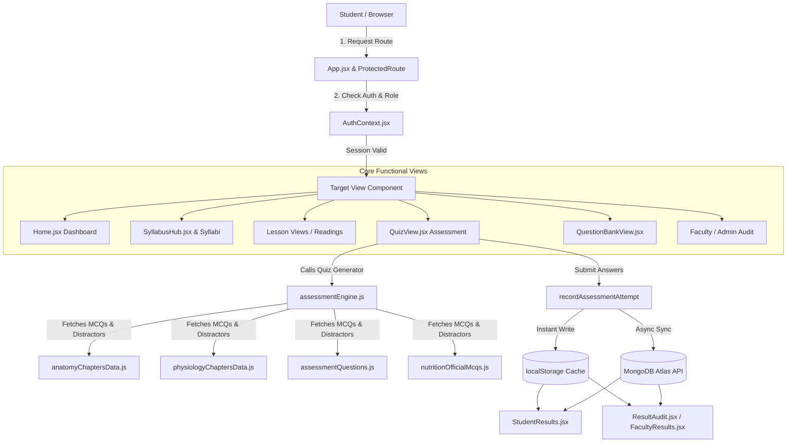
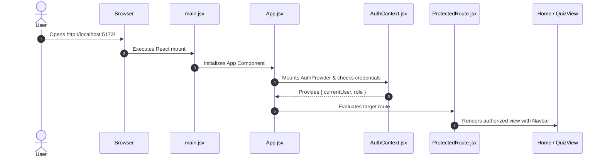
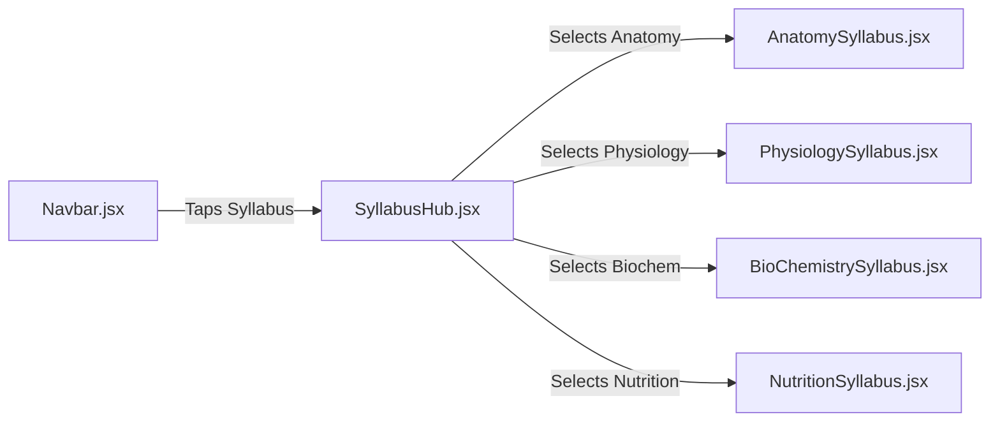
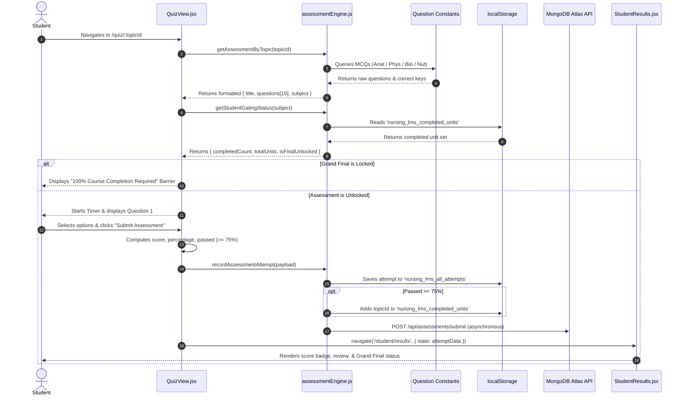
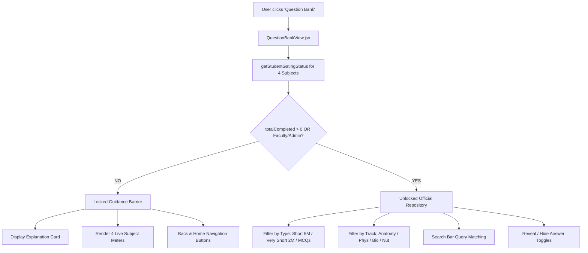

# System Architecture & Code Execution Flow

## Project: Medical & Nursing Learning Management System (LMS)
**Standard**: Indian Nursing Council (INC) Competency-Based Medical Education (CBME)  
**Curriculum**: Applied Anatomy, Applied Physiology, Applied Biochemistry, Applied Nutrition & Dietetics  

---

## 1. High-Level System Architecture Diagram



---

## 2. Execution Flow 1: Application Bootstrap & Authentication

### Sequence of File Execution:
1. `index.html`: Browser loads root HTML shell with `<div id="root"></div>`.
2. `frontend/src/main.jsx`:
   - Imports `React`, `ReactDOM`, `App.jsx`, and `index.css`.
   - Mounts the root component: `ReactDOM.createRoot(document.getElementById('root')).render(<App />)`.
3. `frontend/src/App.jsx`:
   - Wraps the application inside `<AuthProvider>` (`frontend/src/context/AuthContext.jsx`).
   - Instantiates `<BrowserRouter>` and `<Suspense fallback={<PageLoader />}>`.
   - Declares lazy-loaded route definitions.
4. `frontend/src/context/AuthContext.jsx`:
   - Initializes `currentUser`, `role` (`student` | `faculty` | `admin`), and `loading` state from `localStorage` (`user`, `token`, `userRole`).
   - Listens to Firebase Auth state changes via `onAuthStateChanged()`.
   - Exports custom hook `useAuth()`.
5. `frontend/src/components/auth/ProtectedRoute.jsx`:
   - Checks if `currentUser` exists. If not, redirects to `/login`.
   - Checks if `allowedRoles.includes(role)`. If unauthorized, redirects to default dashboard.



---

## 3. Execution Flow 2: Navigation & Syllabus Hub

### Function Call Hierarchy:
1. User clicks **Syllabus** in `Navbar.jsx`.
2. Navigation executes: `navigate('/syllabus')`.
3. `SyllabusHub.jsx` executes:
   - Sets state: `activeSubject = "all"` (or filtered by subject pill).
   - Reads curriculum arrays:
     - `ANATOMY_UNITS` (12 Units) from `constants/anatomyData.js`
     - `PHYSIOLOGY_UNITS` (12 Units) from `constants/physiologyData.js`
     - `biochemUnits` (7 Units) defined in `SyllabusHub.jsx`
     - `nutritionUnits` (10 Units) defined in `SyllabusHub.jsx`
   - User selects a subject card -> router redirects to:
     - `/anatomy-syllabus` -> `AnatomySyllabus.jsx`
     - `/physiology-syllabus` -> `PhysiologySyllabus.jsx`
     - `/bio-chem-syllabus` -> `BioChemistrySyllabus.jsx`
     - `/nutrition-syllabus` -> `NutritionSyllabus.jsx`



---

## 4. Execution Flow 3: Interactive Lesson Reading & Completion

### Step-by-Step Execution:
1. Inside a Syllabus page (e.g., `BioChemistrySyllabus.jsx`), student clicks on a lesson link:
   - Target route: `/biochemistry/lesson/:lessonSlug`
2. `App.jsx` dynamically loads `BiochemistryLessonView.jsx`.
3. In `BiochemistryLessonView.jsx`:
   - Extracts `const { lessonSlug } = useParams()`.
   - Looks up `lesson = BIOCHEMISTRY_SUBMODULES[lessonSlug]` in `constants/biochemistryLessonsData.js`.
   - Initializes completion status:
     ```javascript
     const [completed, setCompleted] = useState(() => {
       const saved = localStorage.getItem("nursing_biochem_completed_lessons");
       return saved ? !!JSON.parse(saved)[`/biochemistry/lesson/${lessonSlug}`] : false;
     });
     ```
   - Renders lesson header, core principle hero card, definitions, pathway steps, clinical pearls, and reference ranges.
4. When student clicks **Mark Complete**:
   - Invokes `toggleCompleted()`.
   - Modifies `nursing_biochem_completed_lessons` object in `localStorage`.
   - Updates UI badge to `Completed ✓`.
   - Returns to `/bio-chem-syllabus` where the unit progress meter automatically updates (`X / Y Lessons Completed`).

---

## 5. Execution Flow 4: Assessment Generation, Gating, & Scoring

This is the core academic competency engine of the platform.



### Key Functions in `frontend/src/services/assessmentEngine.js`:

#### 1. `getAssessmentByTopic(topicId)`
- **Entry Point**: Called on mount by `QuizView.jsx`.
- **Logic**:
  - If `topicId === 'biochem-grand-final'` -> calls `buildBiochemistryGrandFinalAssessment()`.
  - If `topicId === 'nutrition-grand-final'` -> calls `buildNutritionGrandFinalAssessment()`.
  - If `topicId.startsWith('phys-unit-')` -> calls `buildPhysiologyChapterQuiz(unitId, 15)`.
  - If `topicId.startsWith('anatomy-unit-')` -> calls `buildAnatomyChapterQuiz(unitId, 15)`.
  - If `topicId.startsWith('unit-nut-')` -> calls `buildNutritionChapterQuiz(unitId, 15)`.
  - If `topicId` matches Biochem unit -> calls `normalizeBiochemUnit(topicId)` and returns `MODULE_ASSESSMENTS[normalizedBioc]`.
- **Output**: Returns standard assessment object:
  ```json
  {
    "id": "unit-1-carbs",
    "title": "Unit 1: Carbohydrates & Metabolism Assessment",
    "subject": "biochemistry",
    "questions": [ ... ]
  }
  ```

#### 2. `getStudentGatingStatus(subject)`
- **Entry Point**: Called by `QuizView.jsx`, `QuestionBankView.jsx`, `Home.jsx`, and `StudentResults.jsx`.
- **Logic**:
  - Reads `localStorage.getItem('nursing_lms_completed_units')`.
  - Deduplicates completed unit IDs into numerical sets:
    - Anatomy: `unitNums` (1 to 12) -> Total 12
    - Physiology: `unitNums` (1 to 12) -> Total 12
    - Biochemistry: `unitNums` (1 to 7) -> Total 7
    - Nutrition: `unitNums` (1 to 10) -> Total 10
  - Computes `isFinalUnlocked = completedCount >= totalUnits`.
  - Computes `completionPercent = Math.min(100, Math.round((completedCount / totalUnits) * 100))`.

#### 3. `recordAssessmentAttempt(attemptData)`
- **Entry Point**: Called by `handleSubmitQuiz()` in `QuizView.jsx`.
- **Execution Order**:
  1. Generates unique attempt ID: `att-${Date.now()}-${random}`.
  2. Builds record object containing `score`, `totalQuestions`, `percentage`, `passed`, `timeSpentSeconds`, `reviewData`, `completedAt`.
  3. **Local Storage Write**: Appends to `nursing_lms_all_attempts`.
  4. **Gating Progression**: If `passed === true` and not a Grand Final, appends `topicId` to `nursing_lms_completed_units`.
  5. **Cloud Synchronization**: Dispatches asynchronous `fetch('/api/assessments/submit')` with bearer JWT token.

---

## 6. Execution Flow 5: Question Bank Access & Gating Barrier



---

## 7. Execution Flow 6: Faculty & Admin Accreditation Audit

1. Administrator navigates to `/admin/results` (`ResultAudit.jsx`) or Faculty navigates to `/faculty/results` (`FacultyResults.jsx`).
2. Component triggers `useEffect()` on mount:
   - Calls `getAllRecordedAttempts()` from `assessmentEngine.js`.
   - Calls `getStudentRosterHistory()` from `assessmentEngine.js`.
   - Calls `fetch('/api/assessments/attempts')` to fetch cloud records from MongoDB Atlas.
3. Inside `getStudentRosterHistory()`:
   - Groups all platform attempts by `studentEmail` / `studentId`.
   - Computes:
     - `totalAttempts`: Total tests submitted by student.
     - `averageScore`: Sum of percentages divided by total tests.
     - `completedUnitsCount`: Total unique passed units across all 4 tracks.
     - `completionPercentage`: `Math.round((completedUnits.size / 41) * 100)`.
     - `breakdown`:
       - Anatomy: `X / 12`
       - Physiology: `X / 12`
       - Biochemistry: `X / 7`
       - Nutrition: `X / 10`
4. UI renders the institutional compliance audit table with export options, individual student drill-downs, and question-by-question review data.

---

## 8. Summary of State Keys & Storage Locations

| Storage Key | Location | Type | Purpose |
| :--- | :--- | :--- | :--- |
| `nursing_lms_all_attempts` | `localStorage` | Array of Objects | Stores complete attempt history, scores, time spent, and question-by-question answers. |
| `nursing_lms_completed_units` | `localStorage` | Array of Strings | Stores unique IDs of units passed with $\ge 75\%$ score. Controls Grand Final unlocking. |
| `nursing_biochem_completed_lessons` | `localStorage` | Key-Boolean Map | Stores per-lesson reading completion checkboxes in Biochemistry. |
| `user` | `localStorage` | Object | Current authenticated user profile (name, email, role). |
| `token` | `localStorage` | String | JWT authentication bearer token for backend API requests. |
| `attempts` | MongoDB Atlas (`nursing_db`) | Collection | Cloud institutional repository of all student assessment attempts for Dean audits. |
